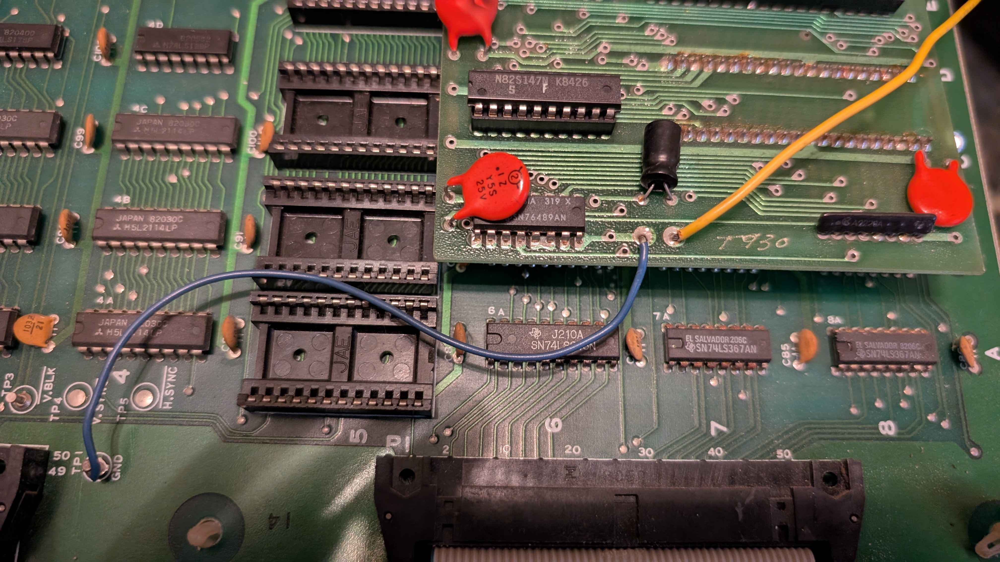
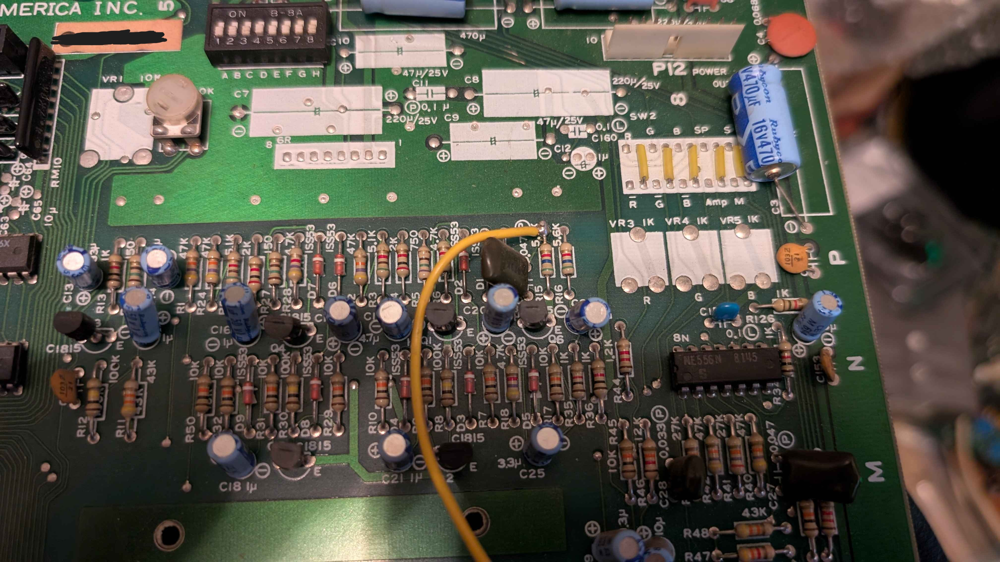
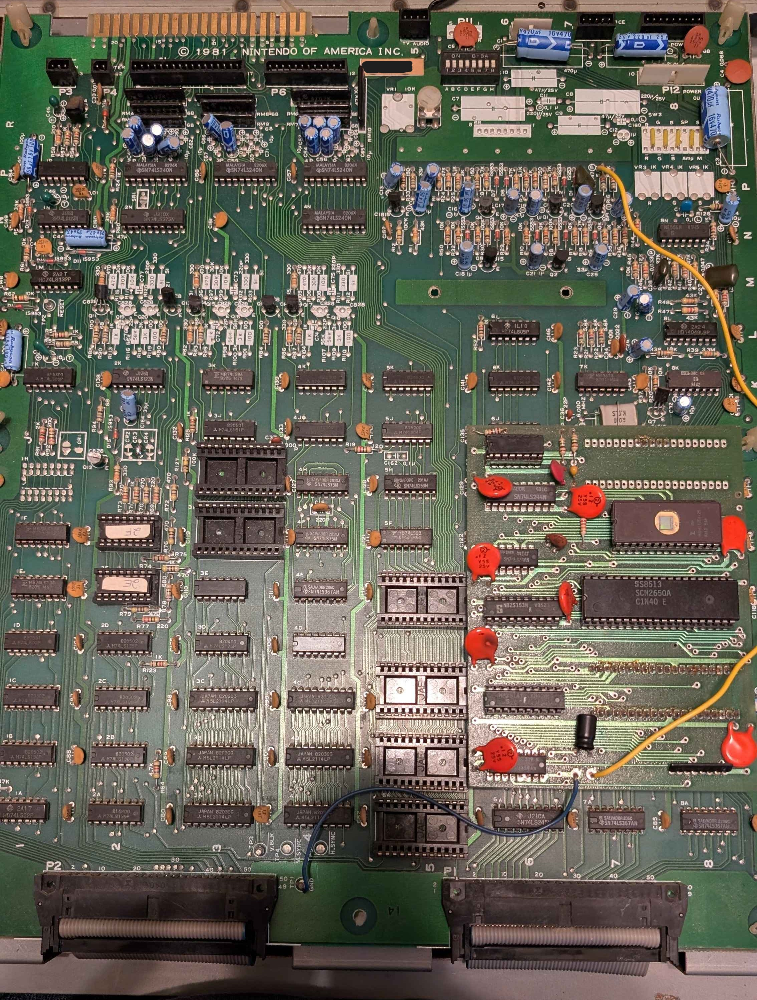
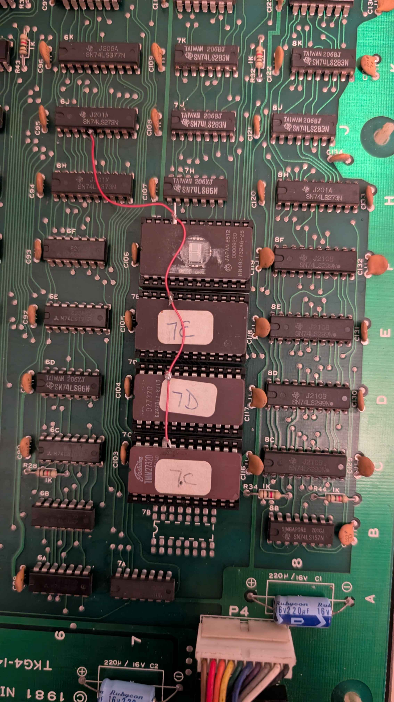
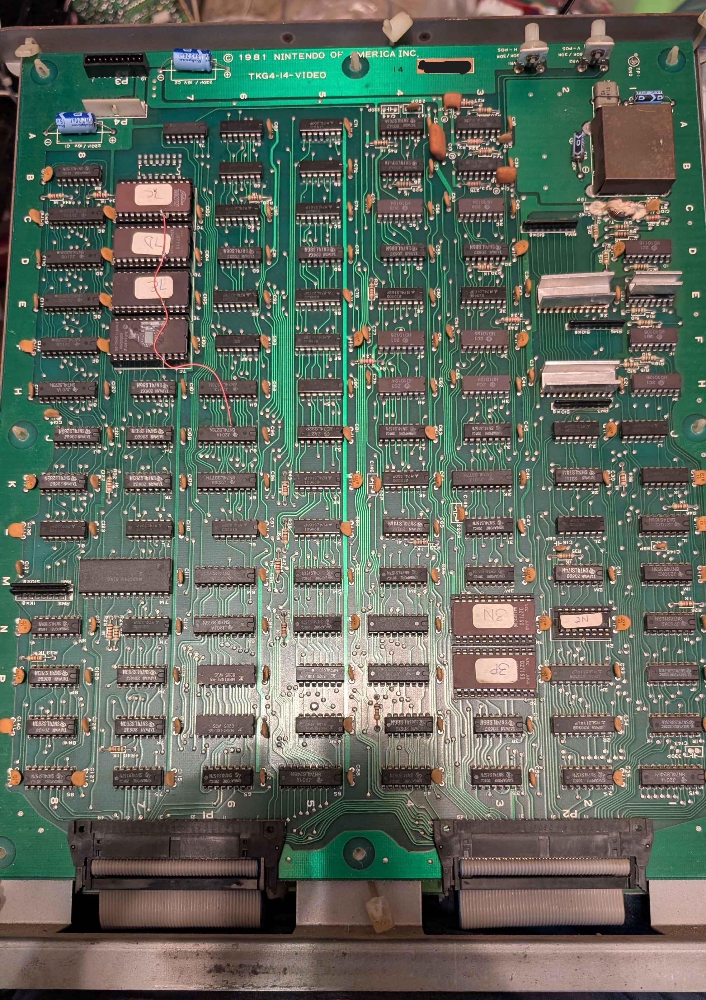

# Special Forces Covnersion Documentation
This provides all the information required to convert a Donkey Kong PCB to *Special Forces: Kung Fu Commando*. This guide applies to TKG4 hardware.

## CPU PCB
All program and sound ROMs should be removed from the CPU board. The CPU and sound MPU will also need to be removed in place of the kit. For the CPU board, you will only be populating the color PROMs, everything else lives on the daughter board.

### Daughter Board
To install the daughter board, remove the Z80 CPU and 8035 MPU. The daughter board fits in both sockets. There are two wires that come off of the daughter board. The wire closest to the SN76489 should be connected to any ground on the CPU PCB. On TKG4 modded boards, they often used the GND test found inbetween the ribbon cable connectors, but any should work realistically. The second wire connects to the end of R15 closer to the connectors. This is the audio

### GND Wire Location

### Sound Out (R15) wire location

### Daughter Board ROM Info
| **Filename** | **ROM Location** | **ROM Type** | **ROM Size** | **CRC32** |
|--------------|:----------------:|:------------:|:------------:|:---------:|
| 27128.8f     |        DB        |    27128     |      16k     |  1E9B8D26 |
| 82s147.prm   |        DB        |    82S147    |      512     |  77BE0931 |
| 82s126.2e    |        2E        |    82S126    |     1k x 4   |  B3751A25 |
| 82s126.2f    |        2F        |    82S126    |     1k x 4   |  1026D438 |

2N on special forces was an 82S126, however the schematics call for a MB7052 or 82S129. It seems like either might work.
There is also an 82S153 PLD on the daughter board. MAME uses the PLD from another conversion kit game.

### CPU PCB Picture

## Video PCB
For the sound PCB, all ROMs will be replaced on this board including the PROM. There is also a mod that needs to be done for the sprite ROMs since they use 2732s instead of 2716.

### Video PCB ROM Info
| **Filename** | **ROM Location** | **ROM Type** | **ROM Size** | **CRC32** |
|--------------|:----------------:|:------------:|:------------:|:---------:|
| 2732.7c      |        7C        |     2732     |      4k      |  C1EA2B17 |
| 2732.7d      |        7D        |     2732     |      4k      |  FE5501F0 |
| 2732.7e      |        7E        |     2732     |      4k      |  F6A113BD |
| 2732.7f      |        7F        |     2732     |      4k      |  42857A7A |
| 2716.3n      |        3N        |     2716     |      2k      |  68C28BCB |
| 2716.3p      |        3P        |     2716     |      2k      |  DFB18C81 |
| 82s126.2n    |        2N        |    82S126    |    1k x 4    |  9735998D |

2N on special forces was an 82S126, however the schematics call for a MB7052 or 82S129. It seems like either might work.

### Sprite ROM Modification
There is one modification that has to be done with the PCB. For each EPROM, A11 (pin 21) must be lifted out of the socket. From there, each of the lifted pins will be tied together using 30AWG wire, leaving enough to run to a chip after. The tied together pins will run to the 74LS273 at 6J pin 5. Refer to the image below for an example of this modification.

### Video PCB Picture
